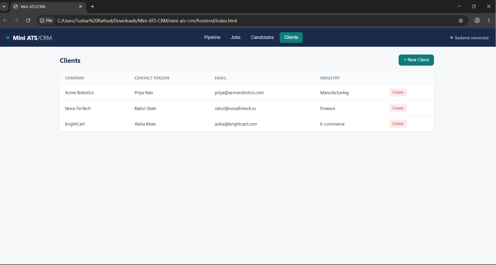
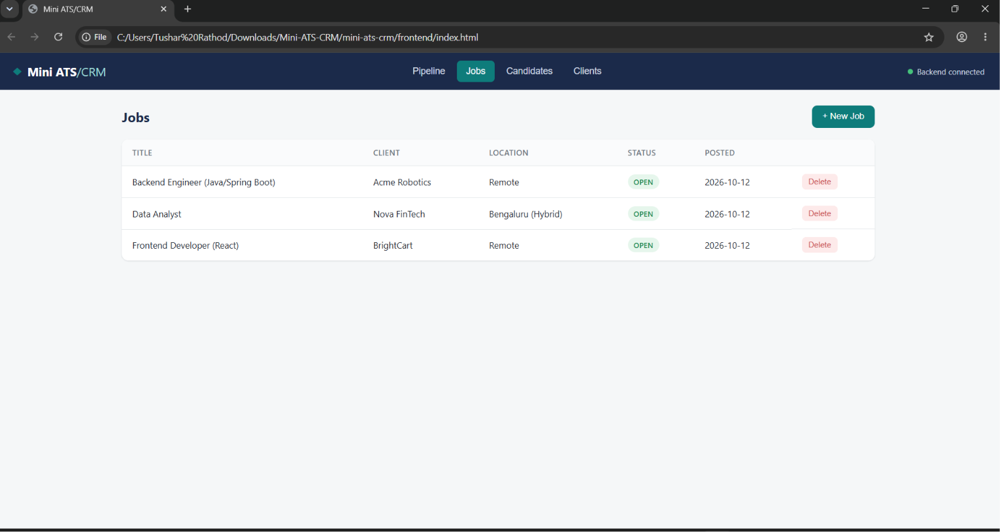
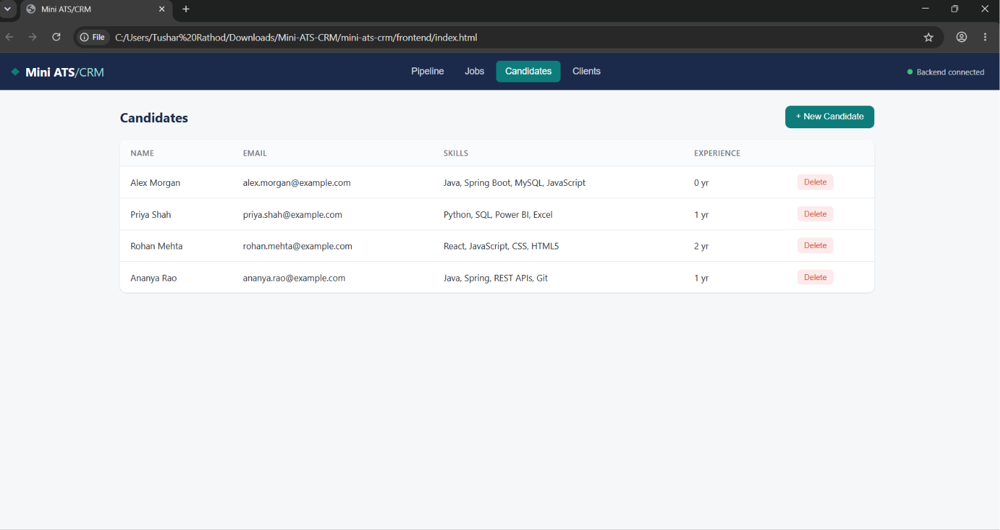
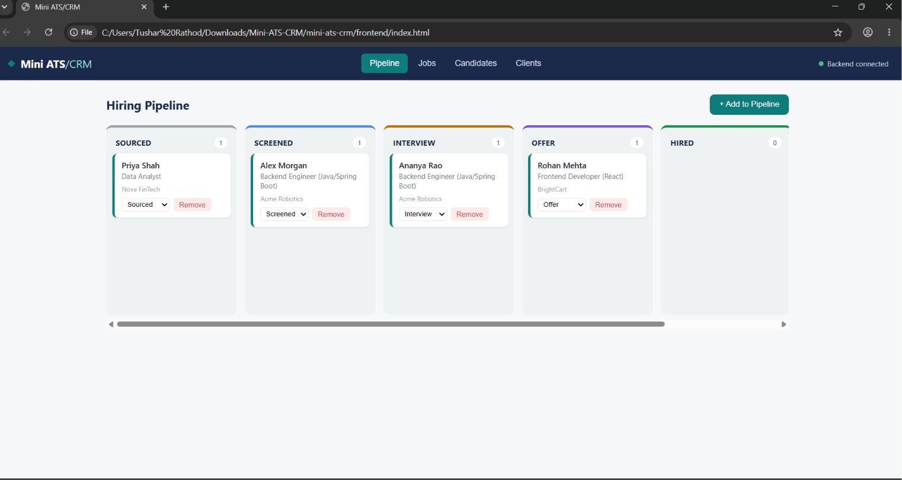

# Mini ATS/CRM

A portfolio-ready **Applicant Tracking System (ATS) + Client Relationship Management (CRM)** built with **Java 17, Spring Boot, Spring Data JPA, Hibernate, H2/MySQL, and Vanilla JavaScript**.

Mini ATS/CRM helps recruitment teams manage **clients, job openings, candidates, and candidate applications** through a visual **Kanban hiring pipeline**.

---

## ✨ Features

* Client management
* Job management with client relationships
* Candidate management
* Candidate-to-job application tracking
* Visual Kanban hiring pipeline
* Pipeline stages:
  `Sourced → Screened → Interview → Offer → Hired / Rejected`
* Drag-and-drop pipeline stage updates
* Dropdown alternative for changing pipeline stages
* RESTful Spring Boot API
* Spring Data JPA and Hibernate
* DTO-based application responses
* Bean Validation
* Centralized exception handling
* Duplicate application protection
* H2 database for zero-setup local development
* MySQL support for production
* Configurable CORS
* Backend health-check endpoint
* Sample demo data
* GitHub Actions workflow for frontend deployment

---

# 🛠️ Tech Stack

## Backend

* Java 17
* Spring Boot 3.2.5
* Spring Web
* Spring Data JPA
* Hibernate
* Spring Validation
* H2 Database
* MySQL
* Maven

## Frontend

* HTML5
* CSS3
* Vanilla JavaScript
* Fetch API
* HTML5 Drag and Drop API

---

# 📁 Project Structure

```text
mini-ats-crm/
│
├── backend/
│   ├── pom.xml
│   │
│   └── src/
│       ├── main/
│       │   ├── java/com/miniats/
│       │   │   ├── config/
│       │   │   ├── controller/
│       │   │   ├── dto/
│       │   │   ├── model/
│       │   │   ├── repository/
│       │   │   └── MiniAtsApplication.java
│       │   │
│       │   └── resources/
│       │       ├── application.properties
│       │       └── application-prod.properties
│       │
│       └── test/
│
├── frontend/
│   ├── index.html
│   │
│   ├── css/
│   │   └── style.css
│   │
│   └── js/
│       ├── config.js
│       └── app.js
│
├── .github/
│   └── workflows/
│       └── deploy-frontend.yml
│
├── .gitignore
└── README.md
```

---

# 🏗️ Architecture

```text
                  USER
                   │
                   ▼
          ┌─────────────────┐
          │    Frontend     │
          │ HTML/CSS/JS     │
          └────────┬────────┘
                   │
                   │ REST API
                   ▼
          ┌─────────────────┐
          │ Spring Boot API │
          │                 │
          │ Controllers     │
          │ DTOs            │
          │ Repositories    │
          │ JPA / Hibernate │
          └────────┬────────┘
                   │
                   ▼
             ┌───────────┐
             │ Database  │
             │ H2/MySQL  │
             └───────────┘
```

The `Application` entity acts as the bridge between a **Candidate** and a **Job**.

It stores additional application-specific information such as:

* Pipeline stage
* Applied date
* Notes

This allows the system to represent candidate applications independently from the candidate and job records.

---

# 💻 Run Locally

## Prerequisites

Install:

* JDK 17+
* Maven 3.6+
* Python 3.x
* Modern web browser

MySQL is optional for local development because the default configuration uses H2.

---

## 1. Start Backend

Open a terminal in:

```text
backend/
```

Run:

```bash
mvn clean spring-boot:run
```

The backend runs locally on:

```text
http://localhost:8091
```

### Health Check

Open:

```text
http://localhost:8091/api/health
```

Expected response:

```json
{
  "status": "UP"
}
```

---

## 2. Start Frontend

Open another terminal in:

```text
frontend/
```

Run:

```bash
python -m http.server 5500
```

Open:

```text
http://localhost:5500
```

The local frontend communicates with:

```text
http://localhost:8091/api
```

---

# 🔌 API Reference

Base URL:

```text
/api
```

## Health

| Method | Endpoint  | Purpose              |
| ------ | --------- | -------------------- |
| GET    | `/health` | Check backend status |

## Clients

| Method | Endpoint        | Purpose       |
| ------ | --------------- | ------------- |
| GET    | `/clients`      | List clients  |
| GET    | `/clients/{id}` | Get client    |
| POST   | `/clients`      | Create client |
| PUT    | `/clients/{id}` | Update client |
| DELETE | `/clients/{id}` | Delete client |

## Jobs

| Method | Endpoint                     | Purpose           |
| ------ | ---------------------------- | ----------------- |
| GET    | `/jobs`                      | List jobs         |
| GET    | `/jobs/{id}`                 | Get job           |
| GET    | `/jobs/by-client/{clientId}` | Jobs for a client |
| POST   | `/jobs`                      | Create job        |
| PUT    | `/jobs/{id}`                 | Update job        |
| DELETE | `/jobs/{id}`                 | Delete job        |

## Candidates

| Method | Endpoint           | Purpose          |
| ------ | ------------------ | ---------------- |
| GET    | `/candidates`      | List candidates  |
| GET    | `/candidates/{id}` | Get candidate    |
| POST   | `/candidates`      | Create candidate |
| PUT    | `/candidates/{id}` | Update candidate |
| DELETE | `/candidates/{id}` | Delete candidate |

## Applications

| Method | Endpoint                       | Purpose                   |
| ------ | ------------------------------ | ------------------------- |
| GET    | `/applications`                | List applications         |
| GET    | `/applications/{id}`           | Get application           |
| GET    | `/applications/by-job/{jobId}` | Applications for a job    |
| POST   | `/applications`                | Add candidate to pipeline |
| PATCH  | `/applications/{id}/stage`     | Change pipeline stage     |
| PUT    | `/applications/{id}/notes`     | Update application notes  |
| DELETE | `/applications/{id}`           | Remove application        |

---
📸 Screenshots

Add your application screenshots to the screenshots/ folder in the repository.

1. Client Management



2. Job Management



3. Candidate Management



4. Kanban Hiring Pipeline



5. Application Tracking


# 📸 Project Highlights

### Client Management

Manage recruitment clients and their contact information.

### Job Management

Create job openings and associate them with clients.

### Candidate Management

Maintain candidate information, skills, experience, and resume links.

### Kanban Hiring Pipeline

Track candidates visually through:

```text
Sourced
   ↓
Screened
   ↓
Interview
   ↓
Offer
   ↓
Hired
```

Rejected candidates can be moved to:

```text
Rejected
```

# 🔮 Future Enhancements

* Spring Security + JWT authentication
* Recruiter/user roles
* Candidate search and pagination
* Resume upload and parsing
* Advanced candidate filtering
* Email notifications
* Dashboard analytics
* Pipeline history
* Audit logs
* Automated unit and integration tests
* CI/CD quality gates
* Production backend deployment
* Production MySQL database

---

# 📜 License

This project is intended for learning, portfolio demonstration, and further development.
